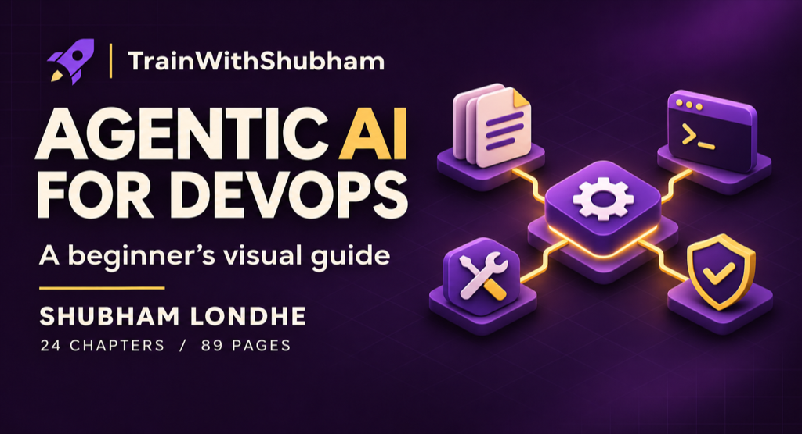

# Agentic AI for DevOps

Learn how an AI agent reads evidence, calls tools and prepares a change for review. Start with a failed CI job, then build a document-search pipeline and explore a complete application.

**Two days · 3 hours each day · November 14–15, 2026**

For freshers and working engineers who know a little Python, Linux and DevOps. AI experience is optional. Breaks and questions are included.

[Set up your laptop](setup/README.md) · [Start module 1](module-1/README.md) · [Get unstuck](checkpoints/README.md) · [Look up a term](GLOSSARY.md)

## Get your first result

Install [Git](https://git-scm.com/downloads) and [uv](https://docs.astral.sh/uv/getting-started/installation/) first. uv installs the course's Python packages and can download a compatible Python version. The [setup guide](setup/README.md) has Windows and macOS/Linux steps.

```bash
git clone --branch v2 https://github.com/TrainWithShubham/agentic-ai-for-devops.git
cd agentic-ai-for-devops
uv sync --frozen --python 3.12
uv run python -m course_labs.prompts
```

You should see a CI explanation with `mode: offline fixture, no LLM call`, a missing `pytest` command and a proposed fix. **No pipeline is changed.** Here, offline means the answer is prepared for learning; no AI model is called. The first install needs internet access.

No API key, subscription, AWS account, Docker or Kubernetes cluster is needed for modules 1–5. Try live AI later using [your own optional model access](setup/README.md#optional-live-model).

## Follow the course

| Day | Module | What you will do |
|---|---|---|
| 1 | [1. AI and system prompts](module-1/README.md) | Explain a failed CI job using its log |
| 1 | [2. Agents, tools and MCP](module-2/README.md) | Watch tool requests become checked actions |
| 1 | [3. RAG pipelines](module-3/README.md) | Find deployment guidance in PDF, DOCX, PPTX, Markdown and text |
| 2 | [4. Identity, guardrails and approval](module-4/README.md) | Reject a request from the wrong role or a changed proposal |
| 2 | [5. Agent harnesses and operations](module-5/README.md) | Inspect cache results, traces and failed evaluations |
| 2 | [6. RunbookOps capstone](module-6/README.md) | Explore a complete agent application and make one small change |

Each module follows the same path: understand the idea, run an example, inspect the result, change one thing and check it. Modules 1–5 use small examples in this repository. Module 6 introduces [RunbookOps](https://github.com/TrainWithShubham/runbookops), a separate application, plus an instructor-led AgentCore demonstration.

## Where to find things

| Folder | Use it for |
|---|---|
| `course_labs/` | Read the short Python examples |
| `data/` | Inspect the made-up CI logs and company documents |
| `exercises/` | Make your learner changes |
| `solutions/` | Compare with a completed answer when stuck |
| `prompts/` | Read the instructions sent to the model |

Start with [module 1](module-1/README.md). You do not need to read every Python file first. To check your installation, run `uv run python scripts/check_course.py`; successful output ends with `OK`.

## Read alongside the course



The [89-page visual e-book](output/pdf/agentic-ai-for-devops-visual-ebook.pdf) explains the concepts through illustrations and short DevOps examples. Its 24 chapters include Claude Code practices, Temporal, AgentCore and a learning path for AIOps, MLOps and LLMOps. It needs no setup. [Download individual chapters](output/pdf/agentic-ai-for-devops-chapters.zip).

<details>
<summary>Instructor and maintainer information</summary>

[Timed curriculum](CURRICULUM.md) · [Instructor start page](instructor/START_HERE.md) · [Delivery plan](instructor/DELIVERY_PLAN.md) · [Verification](instructor/VERIFICATION.md) · [Working context](CONTEXT.md) · [Decisions](DECISIONS.md)

Work is on `v2`. `v1` preserves the earlier course; `main` is unchanged. Application code and AWS deployment instructions stay in the separate project. Run documentation checks with `uv run python scripts/verify_docs.py`.

</details>
