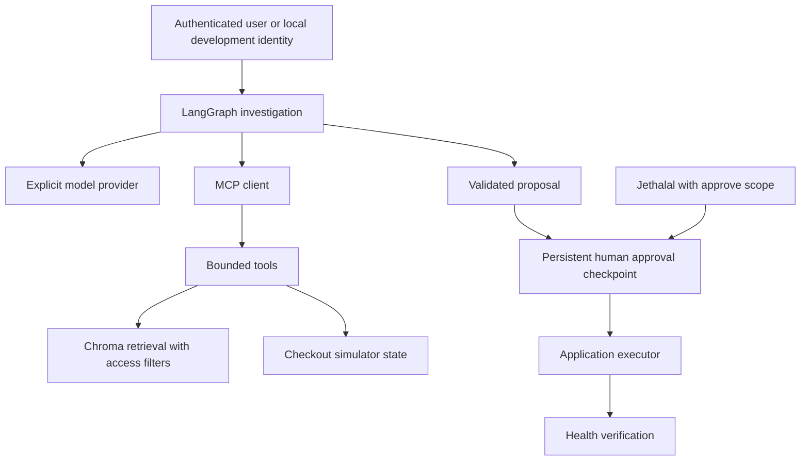

# How RunbookOps works

The model chooses permitted read and proposal tools. The application validates the tool name and arguments and binds calls to a trusted user and incident. Four operational/document checks are required before a proposal can be prepared.

The model has no apply tool. The graph pauses on the stored proposal; a separate authorized decision updates its status. The executor checks the approved hash and current service state, applies one allowlisted simulator change, and verifies the resulting health.

Knowledge documents are extracted into source-located sections, chunked, embedded, and stored in Chroma. Metadata marks source identity, version, freshness, and access. The query filters run before any result enters model context. Both a fully offline lexical hash mode and a small downloaded semantic embedding model are available and labeled.

Local state uses SQLite for operations and a separate SQLite LangGraph checkpointer. The instructor deployment uses a DynamoDB incident aggregate and the maintained DynamoDB LangGraph saver. DynamoDB uses conditional writes for approval and simulator changes. PostgreSQL adapters remain optional but are not the deployed workshop route.

AgentCore Runtime hosts this code. Its managed Harness is a separate alternative orchestration loop powered by Strands. The cloud demo uses Bedrock inference; learner applications use individual OpenRouter keys. The instructor's credits and credentials are never distributed to learners.

The simulator represents a payment dependency through state and log fixtures. It does not make a real payment request. That keeps failure injection repeatable while teaching the evidence, authorization, and recovery boundaries.
