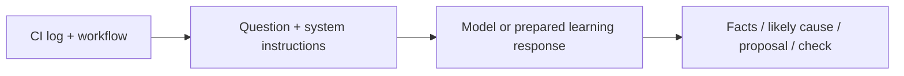

# Module 1: AI foundations and system prompts

**Day 1 · 45 minutes** · [Setup](../setup/README.md) · [Glossary](../GLOSSARY.md)

You will explain a failed CI job, separate evidence from a guess and write instructions that make the answer easier to check. Run commands from the course folder.

## Understand the idea

| Term | In everyday words |
|---|---|
| AI | Software techniques for tasks such as prediction and decision-making |
| Machine learning | Learning patterns from data |
| Generative AI | Producing content such as text, code or images |
| LLM | A language model that responds using learned patterns and the context supplied to it |
| Chat application | A product around models, messages and sometimes tools |
| Agent | A loop in which a model can choose the next permitted step |

Use a script for a known rule. Use a workflow when code defines the routes between steps. Consider an agent when choosing the next check from varied evidence is useful. Installing CI dependencies can stay deterministic even when an agent helps diagnose a failure.

A prompt is a request. System instructions describe the task and limits; context includes the messages, files and tool results available now. Context engineering means choosing and maintaining that information. Tokens are the units models process; the context window is finite and is not permanent memory. Models can produce outdated or unsupported answers.



Logs and documents are untrusted evidence. A sentence inside a log cannot grant permission. System instructions guide the model; application code must enforce what can run.

## Run the example

```bash
uv run python -m course_labs.prompts
```

## Read the result

Look for these fields in the answer:

| Field | What it tells you |
|---|---|
| `mode` | `offline fixture, no LLM call`: a prepared learning response |
| `observed` | `pytest` could not start |
| `likely_cause` | The install excluded the development dependency group |
| `proposal` | Remove `--no-dev` for this test job |
| `validation` | A person must review and rerun the job; no rerun happened |
| `sources` | `ci-log` and `ci-workflow` |

Open [the log](../data/ci/test-output.txt), [workflow and dependency excerpt](../data/ci/workflow.txt) and [system instructions](../prompts/ci-system.txt). `pytest` is in the development group. No test assertion failed: the runner never started. The program has not edited a real pipeline.

## Change one thing

Edit [exercises/system_prompt.txt](../exercises/system_prompt.txt). Ask for observed facts with source IDs, a likely cause, a minimal proposal and a validation step. Require the response to state what actually ran.

You can try the prompt in ChatGPT/Claude using these synthetic inputs. To test it with this CLI, copy your chosen wording into `prompts/ci-system.txt`; that is the file the CLI reads. Review the diff first.

Optional coding-assistant prompt:

> Help me improve this CI investigator's response format. Keep its read-only boundary. Explain each instruction. Do not invent a successful rerun or new permissions.

## Check your work

In the prepared response, identify one fact, one inference and one proposed action. Then explain why valid JSON can still contain a wrong diagnosis.

The offline response is fixed: changing the prompt changes the displayed instructions, not the prepared answer. For a real model comparison, configure [optional live access](../setup/README.md#optional-live-model), then run:

```bash
uv run python -m course_labs.prompts --live
```

The live answer can vary. Check its sources and reject any claim of a fix without an execution result.

## If you get stuck

If packages or commands are missing, return to [setup](../setup/README.md). For wording ideas, read `prompts/ci-system.txt`. You do not need live access to understand the prepared example.

**Next:** [Module 2: agents, tools and MCP](../module-2/README.md).
