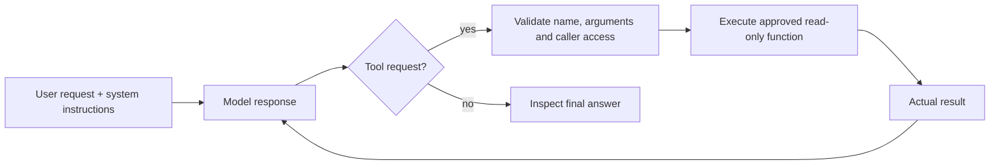

# Module 2 — agents, tool calling and MCP

Day 1, 50 minutes. This module investigates synthetic CI run 1042 with three read-only tools.

## Follow the loop before the framework



A tool call is structured model output. It becomes an action only when application code dispatches it. A tool schema helps a model choose valid arguments; the handler must validate them again. A model should receive errors as observations where recovery is safe, and the application must stop at its budget.

```bash
uv run python -m course_labs.agent
```

The offline model requests are scripted and labeled. The Python tool functions actually run. Inspect [agent.py](../course_labs/agent.py) and [tools.py](../course_labs/tools.py). Find the message list, tool dispatch, tool-call IDs and the four-call/six-tool-step limits.

```bash
uv run python -m course_labs.agent --live
```

This asks a real free model to choose tools. It may request several tools in one turn or stop early. Inspect its source use; a fluent final answer is not proof it checked the workflow. Provider failures remain failures, with no automatic mode switch.

## Practical: summarize a verified CI result

Complete [exercises/ci_summary.py](../exercises/ci_summary.py), then run:

```bash
uv run python scripts/check_exercise.py ci
```

The function accepts only run 1042 with required fields. It returns the run ID, conclusion and failed step. Try an unknown run ID and missing fields. Use the [completed version](../solutions/ci_summary.py) to catch up.

AI coding prompt:

> Implement only ci_summary using its documented contract. Reject an unknown run ID, missing fields and an invalid conclusion. Do not add network calls, shell execution or an LLM dependency. Explain the validation before returning the summary.

## MCP: a standard connection to tools

MCP is a protocol, not an LLM or an agent framework. A host application uses an MCP client to talk to a server. The server advertises tool names and schemas; the client can call them and receive results. The host still decides how models, users and tools interact.

```bash
uv run python -m course_labs.mcp_client
```

This launches [mcp_server.py](../course_labs/mcp_server.py) in a separate Python process and performs an actual stdio exchange. Read the discovered schemas and the returned log. No model is called by this command. Compare it with the direct Python-tool loop above: same CI evidence, different connection boundary.

Use stdio for this local exercise. Remote servers commonly use Streamable HTTP and need an appropriate authorization design. An MCP tool's read-only annotation helps describe behavior; it is not an access-control implementation. An MCP server can run code and must be treated as trusted software before installation.

To inspect locally with MCP Inspector, follow [the official inspector instructions](https://modelcontextprotocol.io/docs/tools/inspector) and point it at `uv run python -m course_labs.mcp_server`. The tested course client above provides the no-Node path.

## LangGraph: make state and transitions visible

```bash
uv run python -m course_labs.graph
# Optional live model, using the same free-only provider:
uv run python -m course_labs.graph --live
```

Read [graph.py](../course_labs/graph.py). `State` holds messages and counters. The model node requests a tool or ends. The tools node returns observations, then control returns to the model. This is the same design expressed as a graph. State here is in memory; compiling a graph alone does not make it durable across process restarts.

The graph demonstration does not call the MCP server. Keeping the small examples separate lets you inspect the loop, protocol and framework without hiding one inside another.

## Check understanding

Point to the function that actually reads a log. Explain which part is a model, which part is MCP and which part is LangGraph. Predict what happens when the model requests an unknown run or keeps calling tools.

Continue with [module 3](../module-3/README.md).
