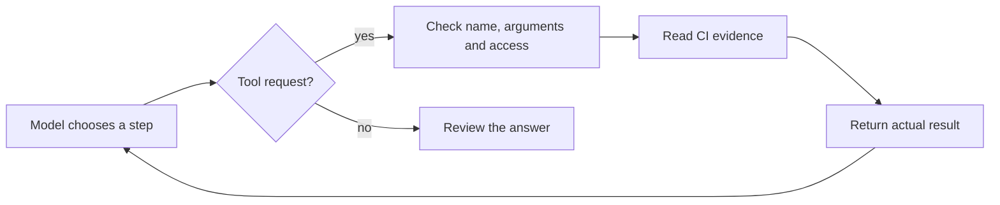

# Module 2: agents, tool calling and MCP

**Day 1 · 50 minutes** · [Previous](../module-1/README.md) · [Glossary](../GLOSSARY.md)

You will follow a request from the model to a real tool, inspect an MCP exchange and recognize the same loop in LangGraph. All examples investigate synthetic CI run **1042**.

## Understand the loop



A tool call is a request containing a tool name and arguments. The application checks and executes it. A schema describes the expected fields; the handler must still validate them. A budget limits how much work a run may do.

## Run the agent

```bash
uv run python -m course_labs.agent
```

You should see three `kind: tool` events with these `source_id` values, followed by an answer:

```text
ci-run → ci-log → ci-workflow → recommendation
```

The final status is `read-only recommendation; no CI change applied`. Offline tool choices are prepared, but the Python tools really read the supplied files. A live model can choose a different order.

Read [agent.py](../course_labs/agent.py) in this order: `fixture_message`, `run`, then the tool loop. `fixture_message` supplies the prepared model replies. Read [tools.py](../course_labs/tools.py) to find validation and file access. Limits are four model calls and six tool steps; exceeding a limit stops the run.

After [optional live setup](../setup/README.md#optional-live-model), `uv run python -m course_labs.agent --live` lets a real model select tools. It may stop early or request multiple tools in a turn. Inspect the actual results instead of assuming the answer used every source.

## See MCP in action

MCP is a shared protocol for connecting an AI application to capability servers. The host is the application, the client talks to a server, and the server exposes tools or context.

```bash
uv run python -m course_labs.mcp_client
```

Look for `transport: stdio`, `model_called: false`, the three tool names and a `ci_read_log` result containing `source_id: ci-log`. Some library startup messages may appear too.

This starts a separate local Python server and performs real discovery and a tool call. **stdio** means the processes communicate through standard input/output. Remote servers commonly use Streamable HTTP. Local and remote connections need suitable trust and authorization controls. A local server runs code on your laptop; review its source, startup command and permissions. A read-only tool annotation describes intent, not enforced access control.

The plain agent calls Python functions directly. This MCP example has no model. They share evidence, but are separate examples so each connection is visible. If you want an optional visual inspection tool, follow [the official MCP Inspector guide](https://modelcontextprotocol.io/docs/tools/inspector); the course client itself needs no Node.js.

## See the loop as a graph

```bash
uv run python -m course_labs.graph
```

You should see `node: model` and `node: tools` events, then an answer and `state_scope: in-memory only; persistence is a separate feature`.

In [graph.py](../course_labs/graph.py), **state** holds messages and counters, **nodes** do work, and **edges** route to the next step. Find `State`, the two node functions and `add_conditional_edges`. Compiling this graph does not make it survive a restart. It does not call the MCP server. Optional `--live` uses the same provider as the plain agent.

## Change one thing

Complete [exercises/ci_summary.py](../exercises/ci_summary.py). Return a string containing the known run ID, conclusion and failed step. Reject missing fields, an unknown run and an invalid conclusion with `ValueError`.

```bash
uv run python scripts/check_exercise.py ci
```

Success prints `Passed: ci`. `Not passed yet` is expected before you finish the starter.

Optional coding-assistant prompt:

> Implement only ci_summary using its contract. Explain the input checks. Do not add network calls, shell execution or a model dependency.

## Check your understanding

Point to the function that reads the log. Explain which part is a model, MCP and LangGraph. Predict what happens with an unknown run ID or repeated tool requests.

Stuck? Compare [the solution](../solutions/ci_summary.py), or run `uv run python scripts/check_exercise.py ci --solution`. This checks the completed example without changing your file. Use [recovery checkpoints](../checkpoints/README.md) if setup fails.

**Next:** [Module 3: RAG pipelines](../module-3/README.md).
