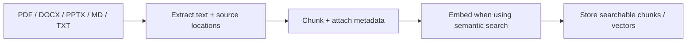
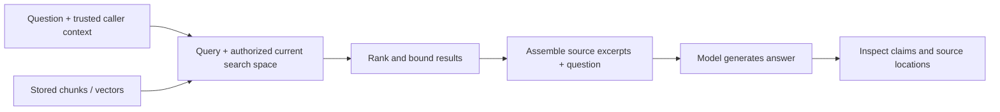

# Module 3 — RAG pipelines for deployment knowledge

Day 1, 60 minutes. RAG means retrieval-augmented generation: find relevant external evidence, add it to a model request and ask for an answer grounded in that evidence. It does not retrain the model.

## What is a RAG pipeline?

A pipeline is the sequence that turns source documents and a question into retrieved context and an answer. It has two paths with different operational responsibilities.



This preparation path runs when documents are added or changed. A production ingestion job also needs source permissions, deletion handling, versioning, extraction failures and freshness checks.



The query path should retrieve evidence the caller may read. A similarity score measures a matching function; it is not a probability that a claim is true. Retrieval can return the wrong document, extraction can lose meaning and a model can misuse a valid citation.

## Open the corpus

Inspect [data/deployment-docs](../data/deployment-docs/manifest.json):

| File | What to inspect |
|---|---|
| `release-process.md` | Current deployment and promotion steps |
| `deployment-policy.txt` | Engineer and release-manager responsibilities |
| `rollback-checklist.pdf` | Approval and validation, with a page citation |
| `release-incident.docx` | Historical incident with paragraph locations |
| `deployment-architecture.pptx` | Deployment flow with a slide citation |
| `old-release-process.md` | Retired guidance retained for the freshness check |
| `restricted-operations.txt` | A role-restricted document for the access exercise |

These files were created for teaching. DOCX tables, slide diagrams, scanned pages and complex layouts need more extraction work than this small text-focused loader provides. A scanned PDF needs OCR; this example does not pretend OCR happened.

## Run the pipeline and inspect each stage

```bash
uv run python -m course_labs.rag
uv run python -m course_labs.rag --question "What does the catalog route depend on?"
uv run python -m course_labs.rag --question "Who is tomorrow's on-call engineer?"
```

The on-call question is unsupported by this corpus. A broad keyword match may still return an excerpt; ask whether it actually supports an answer.

The default backend is keyword retrieval. It performs real extraction, chunking, metadata filtering and search, then displays cited excerpts without calling an LLM. Open `.state/deployment-index.json` to inspect the actual index. The CLI rebuilds the tiny index for each run so edits are visible.

For semantic retrieval:

```bash
# Prepare before class: downloads dependencies and, on first semantic run, the embedding model.
uv sync --frozen --extra semantic
uv run python -m course_labs.rag --backend semantic
```

This path embeds the document chunks during indexing and embeds the question during retrieval using a real local FastEmbed model. It stores the small vectors in the local JSON index and compares cosine similarity. A managed vector database is unnecessary for this corpus; production scale, persistence, filters and operations may justify one.

For a generated answer using retrieved context:

```bash
uv run python -m course_labs.rag --live
# Or combine real semantic retrieval and generation:
uv run python -m course_labs.rag --backend semantic --live
```

`--live` controls answer generation; `--backend` controls retrieval. They are independent choices. Without retrieved context, the example returns a missing-evidence message without calling a model.

## Practical: inspect freshness and permissions

Complete [exercises/source_filter.py](../exercises/source_filter.py). Keep current documents allowed for the supplied role; reject unknown roles. Then run:

```bash
uv run python scripts/check_exercise.py rag
```

Compare with [the solution](../solutions/source_filter.py). In the working pipeline, access/freshness filtering happens in Python before context reaches a model. A role typed into a user prompt must not become trusted authorization. Here `--role` deliberately selects a teaching identity on the learner laptop. In a real service, validated server-side identity supplies that role and the protected index stays behind the service boundary.

Next, change chunk size/overlap in `course_labs/rag.py` or add one sentence to the current deployment document. Rebuild and inspect how excerpts and the corpus fingerprint change. Preserve IDs, locations and filters. Search results may change; explain the observed change rather than assuming smaller chunks are better.

AI coding prompt:

> Explain the preparation and query functions in this file. Help me change chunk settings for one experiment. Keep source metadata, the role filter and retired-document exclusion. Print the retrieved excerpts so I can assess the result myself.

## Deployment questions a DevOps engineer should ask

Where do ingestion failures appear? How does the index learn that a document was deleted? Can a shared cache leak restricted context? Which embedding model/version built the collection? How would you test a stale procedure after a release? What should happen if no source supports the requested action?

Check understanding: trace one PDF page or PPTX slide from extraction through retrieval to the displayed citation. Explain what an embedding model does and what it does not establish about the truth of an answer.

Day 2 starts with [module 4](../module-4/README.md).
