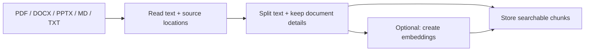
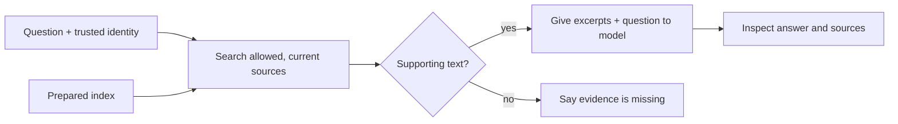

# Module 3: RAG pipelines for deployment knowledge

**Day 1 · 60 minutes** · [Previous](../module-2/README.md) · [Glossary](../GLOSSARY.md)

You will turn company documents into searchable pieces, find supporting passages and inspect their sources. RAG means **retrieval-augmented generation**: find external evidence, give it to a model and ask for an answer. It does not retrain the model.

## Understand the two paths

The **preparation path** runs when documents change:



A chunk is a small piece of text. Metadata records details such as its source, page, version and allowed roles. An embedding represents text as numbers so related passages can be compared.

The **question path** uses that prepared knowledge:



A retrieval failure is different from an empty search result. Report the failure instead of silently answering company-policy questions from model memory. A search score measures a match; it is not the probability that an answer is true.

## Open the documents

The [manifest](../data/deployment-docs/manifest.json) lists the made-up documents and their metadata.

| File | What it teaches |
|---|---|
| `release-process.md` | Current deployment steps |
| `deployment-policy.txt` | Engineer and release-manager responsibilities |
| `rollback-checklist.pdf` | Approval and validation, with a page location |
| `release-incident.docx` | Historical incident, with paragraph locations |
| `deployment-architecture.pptx` | Architecture text, with a slide location |
| `old-release-process.md` | Retired guidance to exclude |
| `restricted-operations.txt` | A document only the release-manager fixture may retrieve |

The loader reads text from all five formats. Scanned PDFs need OCR: software that reads text from an image. DOCX tables, slide diagrams and complex layouts need more processing than this small loader provides.

## Run keyword retrieval

```bash
uv run python -m course_labs.rag
```

You should see `stage: index`, then `stage: retrieval`, then `stage: answer`. In retrieval, inspect each source's `id`, `location`, `score` and `text`. The offline answer says `offline extractive evidence view; no generated answer` and `model_called: false`.

This is real extraction and keyword search, followed by displayed excerpts. It is not a generated answer or semantic search. Open `.state/deployment-index.json` to see the stored chunks. The tiny index rebuilds on every run. `corpus_version` is a fingerprint of the document collection: changing its content or manifest changes that value.

```bash
uv run python -m course_labs.rag --question "zebras astrophysics xyzzy"
uv run python -m course_labs.rag --question "Who is tomorrow's on-call engineer?"
```

The first query returns no matching evidence and does not call a model. The second question is also unsupported, but common words may still retrieve an excerpt. Read it: a matching passage is not necessarily supporting evidence.

## Optional: compare semantic search and generation

After [semantic setup](../setup/README.md#optional-semantic-retrieval):

```bash
uv run python -m course_labs.rag --backend semantic
```

This uses a real local FastEmbed model for document and query embeddings, stored in the JSON index. It compares vectors using cosine similarity, a measure of their direction. Its threshold is a teaching choice, not a universal confidence value. This corpus needs no vector database.

After [live model setup](../setup/README.md#optional-live-model), use `--live` for a generated answer. You can combine both options:

```bash
uv run python -m course_labs.rag --backend semantic --live
```

`--backend` chooses search; `--live` chooses answer generation. Without retrieved context, the example returns a missing-evidence message without calling a model. With context, the live answer still needs source review.

## Change one thing and check it

Complete [exercises/source_filter.py](../exercises/source_filter.py): keep current documents allowed for the supplied role and reject unknown roles.

```bash
uv run python scripts/check_exercise.py rag
```

Success prints `Passed: rag`. Try each teaching role and explain which documents remain. `--role` selects a fixture on your laptop, not an authenticated login. A real service must supply the role from validated identity and protect the index itself.

Then change chunk `size` or `overlap` in [rag.py](../course_labs/rag.py), or add one sentence to a current document. These settings count **characters**, not tokens. Rerun and inspect the chunks, source locations and corpus fingerprint. Keep access and retired-document filters intact.

Optional coding-assistant prompt:

> Explain extract, split, build_index and retrieve. Help me change chunk settings for one experiment. Preserve source metadata and access checks. Show the excerpts so I can assess the result.

A real ingestion service must also track source deletion, changed permissions, extraction failures and stale knowledge. Derived chunks and cached answers need corresponding updates or removal.

If you are stuck, use [the completed filter](../solutions/source_filter.py) and [recovery checkpoints](../checkpoints/README.md). Explain one PDF page or slide's path from extraction to its displayed citation before moving on.

**Next:** [Module 4: identity, guardrails and approval](../module-4/README.md), on Day 2.
